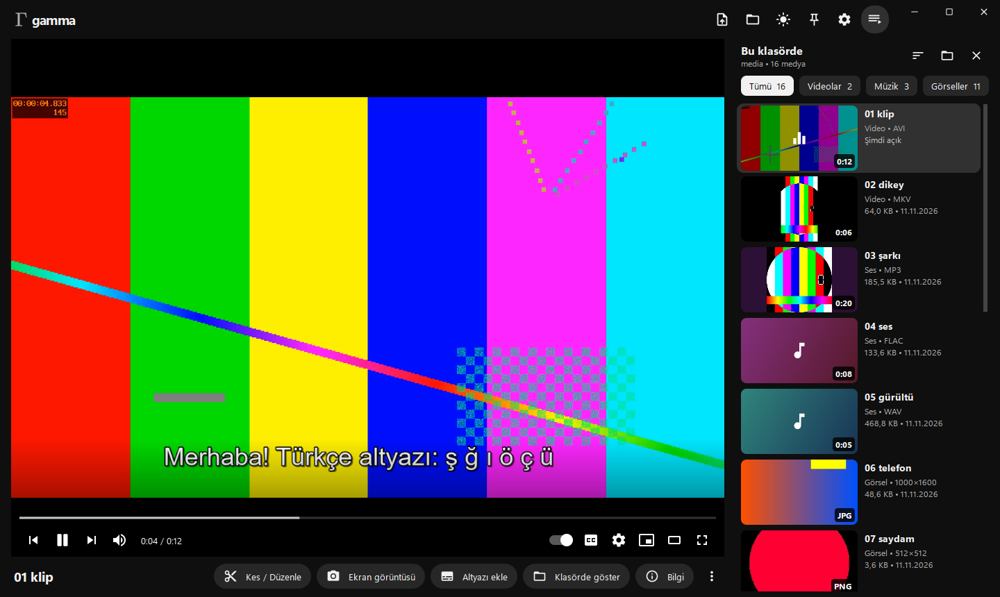
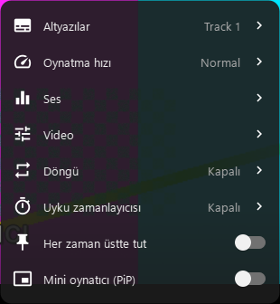
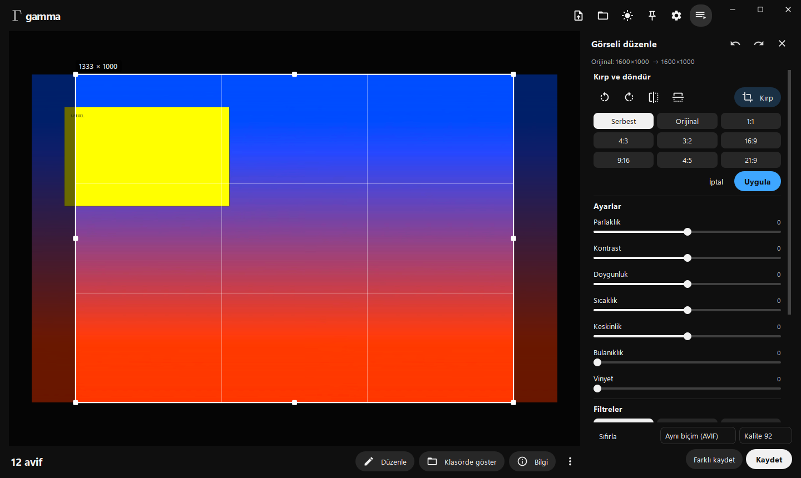
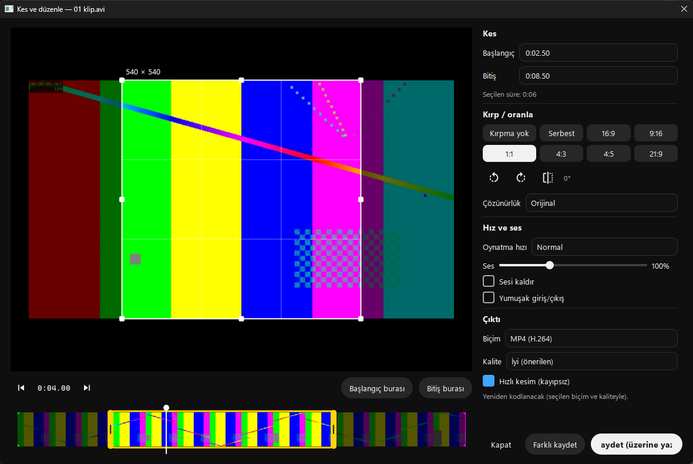
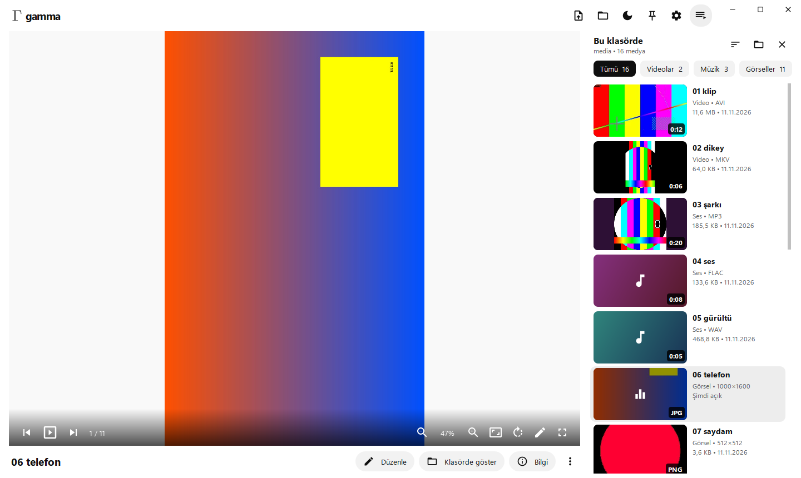

<p align="center">
  
</p>

<h1 align="center">gamma</h1>

<p align="center">
  YouTube görünümlü, VLC motorlu evrensel medya oynatıcı — video, müzik, görseller ve 3D modeller tek pencerede.
</p>

<p align="center">
  
</p>

## İndir ve kur

[**Releases**](../../releases) sayfasından:

- **`gamma-setup-x.y.z.exe`** — kurulum sihirbazı. Başlat menüsü ve masaüstü kısayolu, "Birlikte aç" listesine kayıt, isteğe bağlı sağ tık menüsü ("Open with gamma player"). Yönetici izni istemez (istenirse tüm kullanıcılar için de kurulabilir). Denetim Masası'ndan kaldırılabilir.
- **`gamma-portable-x.y.z.zip`** — kurulumsuz; klasörü açıp `gamma.exe`'yi çalıştırın.

VLC uygulamanın içinde gelir; ayrıca bir şey kurmanız gerekmez. Yalnızca Windows 10/11 64-bit desteklenir.

### Varsayılan oynatıcı yapma

Windows, uygulamaların kendini varsayılan yapmasına izin vermez; seçimi siz yaparsınız:

- **Hepsini birden:** Ayarlar › Uygulamalar › Varsayılan uygulamalar › **gamma** › her uzantı (.mp4, .mkv, .mp3, .jpg…) için *gamma*'yı seçin.
- **Tek bir tür için:** dosyaya sağ tık › **Birlikte aç** › **Başka bir uygulama seç** › **gamma** › *Her zaman*.

## Özellikler

**YouTube tarzı arayüz**
- Solda oynatıcı, altında dosya adı ve işlem düğmeleri; ayrıntılar **Bilgi** düğmesinde
- Sağda **"Bu klasörde"** listesi: klasörde başka dosya varsa otomatik açılır; küçük resimler, süre rozetleri, Tümü / Videolar / Müzik / Görseller / 3D çipleri, sıralama; isteğe bağlı arama çubuğu
- Video üstünde kırmızı zaman çubuğu ve **gezinirken kare önizlemesi**, genişleyen ses kaydırıcısı, otomatik oynatma, ⚙ ayarlar menüsü
- **Karanlık / aydınlık tema**, seçilebilir **tema rengi** (gri, kırmızı, mavi, yeşil…), Türkçe / İngilizce
- Windows **Snap** desteği: kenara/köşeye sürükleyince yarım, çeyrek ve tam ekran; Win+ok tuşları
- Seçenekler'de **Künye**: sürüm, geliştirici, lisans ve kullanılan motorların sürümleri

**Her formatı açar**
- Video: MP4, MKV, AVI, MOV, WebM, WMV, FLV, TS/M2TS, MPG, 3GP… (VLC'nin açtığı her şey)
- Müzik: MP3, FLAC, WAV, M4A, AAC, OGG, Opus, WMA, ALAC… — kapak resmi ve etiketlerle
- Görsel: JPG (EXIF yönü doğru), PNG, WebP, GIF / animasyonlu WebP / APNG, HEIC, AVIF, **JPEG XL**, ICO, SVG, BMP, TIFF, PSD, TGA, QOI…
- **3D model** (3.0): **STL** (ikili / ASCII), **OBJ** (+ MTL renk ve dokular), **GLB / glTF** (sahne, malzeme rengi, doku, köşe rengi), **PLY**, **OFF**, **3MF** — kenar listesinde 3D küçük resimler

**3D görüntüleyici**
- Fareyle döndür (sol sürükle), kaydır (sağ / orta sürükle), tekerlekle yakınlaştır; çift tık tam ekran
- Alttaki çubukta önceki / sonraki model, **otomatik döndürme**, yakınlaştırma, görünümü sıfırla, modeli çevir (Z-yukarı / Y-yukarı karışıklığı için)
- Sağ tık: tel kafes, zemin ızgarası, görüntüyü kopyala / PNG kaydet, model bilgisi (üçgen, köşe, boyut)
- Kurulumla birlikte **Windows Gezgini'nde STL ve OBJ önizlemeleri** (gamma varsayılan uygulamaysa köşede gamma simgesi)

**Oynatma ve pencere**
- Kaldığın yerden devam, döngü, karışık çal, A-B döngüsü, uyku zamanlayıcısı
- Hız 0.25×–4×, ekolayzer, ses parçası/kanalı, %200 ses, ses gecikmesi
- En-boy oranı, kırpma, döndürme, yakınlaştırma, parlaklık/kontrast/doygunluk, deinterlace, ekran görüntüsü
- **Her zaman üstte** ve **mini oynatıcı (PiP)** — düğmelerden ve menülerden açılıp kapanır, Seçenekler'den tamamen devre dışı bırakılabilir
- Tam ekran, sinema modu, tek pencere modu

**Altyazı**
- Gömülü parçalar, aynı adlı `.srt` otomatik yüklenir, dosyadan ekleme veya sürükleyip bırakma
- Gecikme ayarı ve dosyaya özel kaydetme; boyut, renk, arka plan, kenar çizgisi, kalınlık, konum
- Türkçe karakterler için kodlama seçimi (Windows-1254 / ISO-8859-9 / UTF-8)

**Düzenleme**
- **Video / ses**: A–B ile kes, oranla kırp (16:9, 9:16, 1:1, 4:3, 4:5, 21:9, serbest), döndür, çevir, çözünürlük, hız, ses, yumuşak giriş/çıkış → MP4 (H.264/H.265), WebM, MKV, GIF, MP3, M4A, Opus, FLAC, WAV. Değişiklik yoksa kayıpsız hızlı kesim. **Kaydet (üzerine yaz)** veya **Farklı kaydet**.
- **Görsel**: kırp, döndür, çevir, **arka planı kaldır** (beyaz/düz zemini saydam yapar; otomatik veya damlalıkla renk seçimi), parlaklık/kontrast/doygunluk/sıcaklık/keskinlik/bulanıklık/vinyet, 10 filtre, yeniden boyutlandır, geri al → **Kaydet**, **Farklı kaydet** ya da başka biçime dönüştürerek kaydet (PNG, JPG, WebP, AVIF, HEIC, JXL, BMP, TIFF, GIF, ICO, QOI).
- **Biçim dönüştür**: görsele sağ tık › Biçim dönüştür (hızlı PNG / JPG / WebP / **ICO**) — düzenlemeden, orijinali koruyarak. ICO kare ve saydam olarak 16–256 px boyutlarıyla kaydedilir.
- Videoya **yazı / logo (filigran)** ve **altyazı gömme**, ses normalleştirme.

<p align="center">
  
  
</p>
<p align="center">
  
  
</p>

## Kısayollar

| Tuş | İşlev |
|---|---|
| Boşluk / K | Oynat / duraklat (görselde slayt gösterisi) |
| J / L · ← / → | 10 sn / 5 sn geri-ileri (görselde önceki/sonraki) |
| ↑ / ↓ · M | Ses · sessiz |
| F · T · I | Tam ekran · sinema modu · mini oynatıcı |
| C · G / H | Altyazı aç/kapa · altyazı gecikmesi |
| 0–9 · Home / End | Videonun %'sine atla · başa / sona |
| N / P | Sonraki / önceki dosya |
| S · B · E | Ekran görüntüsü · A-B döngüsü · kes/düzenle |
| Ctrl+O · Ctrl+Shift+O | Dosya / klasör aç |
| Ctrl+T · Ctrl+D · F1 | Her zaman üstte · tema · tüm kısayollar |
| 3D: Sürükle · Tekerlek · 0 · R · W · G | Döndür · yakınlaştır · sıfırla · çevir · tel kafes · ızgara |

## Kaynaktan çalıştırma

Python 3.10+ ve 64-bit [VLC](https://www.videolan.org/vlc/) gerekir.

```powershell
git clone https://github.com/yigitozsoy/gamma_player.git
cd gamma_player
python -m pip install -r requirements.txt
python main.py                  # veya: python -m gammaplayer [dosya|klasör]
```

`pip install .` ile kurarsanız `gamma` komutu da eklenir.

### Test

```powershell
python tests/smoke_test.py            # çekirdek + arayüz (yaklaşık 15 sn)
python tests/smoke_test.py --no-gui   # yalnızca çekirdek
```

Test medyasını ffmpeg ile kendisi üretir; gerçek ayarlarınıza dokunmaz.

## Kurulum dosyasını derleme

Gerekenler: Python, 64-bit VLC (gömülmek üzere), [Inno Setup 6](https://jrsoftware.org/isinfo.php) (`winget install JRSoftware.InnoSetup`).

```powershell
powershell -ExecutionPolicy Bypass -File packaging\build.ps1 -InstallDeps
```

Çıktılar `build\installer\` içinde: `gamma-setup-<sürüm>.exe` ve `gamma-portable-<sürüm>.zip`.
Seçenekler: `-NoVlc` (VLC'yi gömme), `-VlcDir <klasör>`, `-SkipInstaller` (yalnızca zip).

GitHub'da `v2.0.0` gibi bir etiket gönderdiğinizde `.github/workflows/build.yml` kurulumu otomatik derleyip Releases'a ekler.

Sürüm numarası tek yerde tutulur: `gammaplayer/__init__.py`.

## Proje yapısı

```
main.py                    kaynaktan başlatıcı
gammaplayer/
  app.py                   giriş noktası, tek pencere modu
  window.py                ana pencere: düzen, oynatma, PiP, pin, tam ekran
  overlay.py               video üstündeki kontroller (ayrı saydam pencere)
  popup_menu.py            ⚙ menü altyapısı · player_menu.py menü sayfaları
  sidebar.py · titlebar.py · views.py      "Bu klasörde" listesi, üst çubuk, ana sayfa/müzik/bilgi
  image_viewer.py · image_editor.py · video_editor.py
  vlc_engine.py            LibVLC sarmalayıcı
  thumbs.py                ffmpeg: küçük resim, süre, kare önizleme, dalga formu
  image_io.py              tüm görsel formatlarını okuma/yazma
  bgremove.py              arka plan kaldırma · watermark.py  yazı/logo bindirme
  library.py · formats.py · config.py · theme.py · icons.py · i18n.py · shortcuts.py · dialogs.py · shell.py · layout_prefs.py
  assets/                  logo ve simge
tests/smoke_test.py        uçtan uca duman testi
packaging/
  build.ps1                tek komutla derleme
  gamma.spec               PyInstaller tanımı
  installer.iss            Inno Setup kurulum betiği
  make_meta.py             sürüm bilgisi + dosya ilişkilendirme listesi üretir
```

Ayarlar ve önbellek: `%LOCALAPPDATA%\gamma`.

## Lisans

Geliştirici: **Yiğit Özsoy** · [GPL-3.0](LICENSE). gamma; [VLC/libVLC](https://www.videolan.org/) (LGPL/GPL), [FFmpeg](https://ffmpeg.org/) (GPL derlemesi, imageio-ffmpeg üzerinden), [PyQt6](https://www.riverbankcomputing.com/software/pyqt/) (GPL), Pillow, pillow-heif ve imagecodecs kullanır. Kurulum paketi bu bileşenlerin lisans metinlerini içerir.
